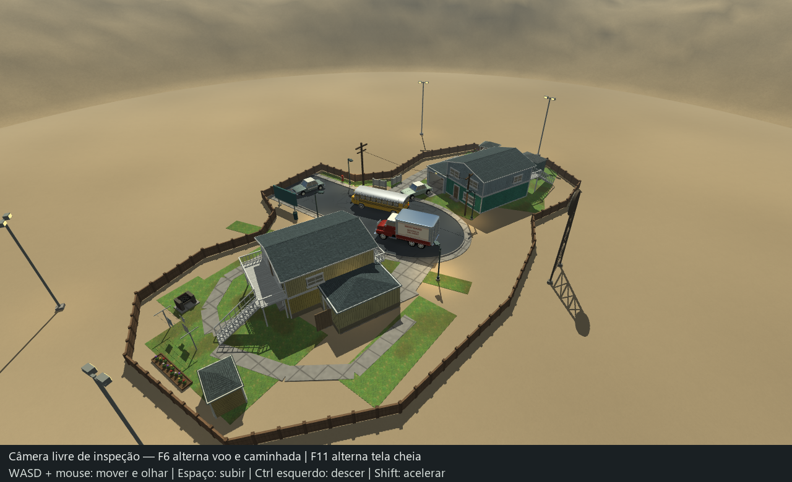
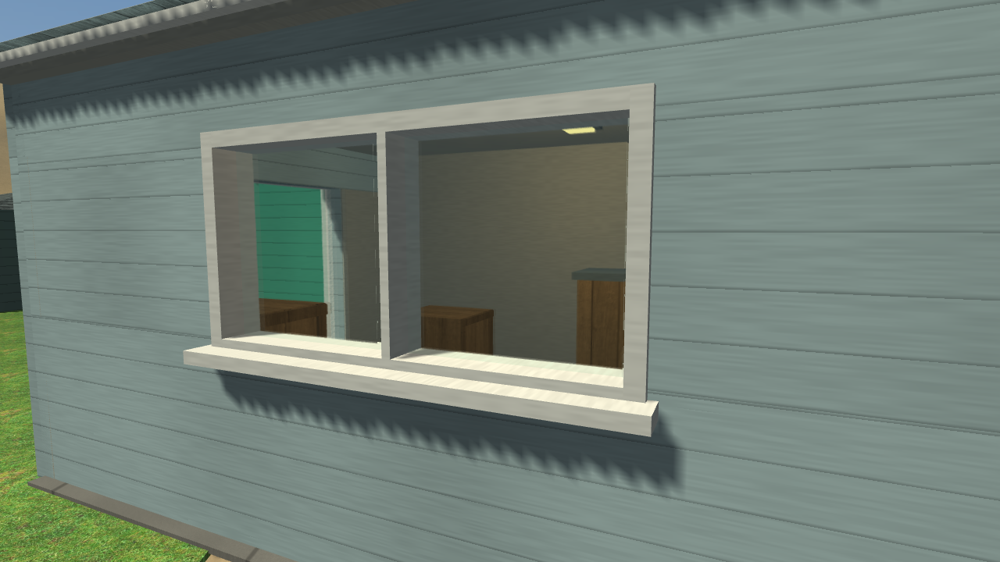
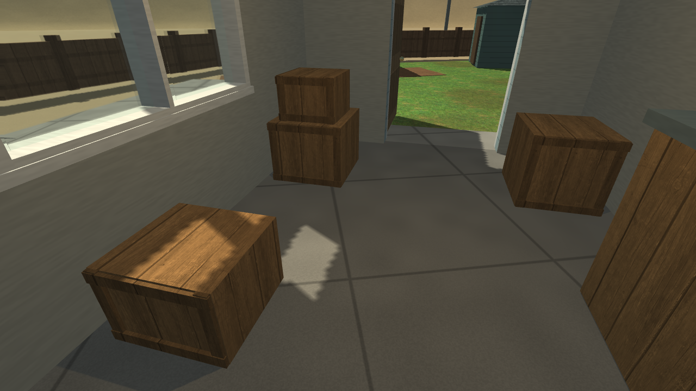

# Nuketown — Computação Gráfica

Projeto acadêmico em C++ e OpenGL, desenvolvido a partir da BaseAppOGL fornecida nas aulas. A cena apresenta uma versão simplificada dos exteriores da Nuketown clássica de Call of Duty: Black Ops: duas casas, garagens, quintais e a praça com ônibus e caminhão. As duas garagens são acessíveis; os interiores principais das casas continuam fechados nesta etapa.



## Estado atual

- Duas casas com fachadas verde e amarela, telhados de duas águas e interiores principais fechados.
- Duas garagens abertas, com caixas, iluminação interna e passagem da entrada principal até a porta aberta nos fundos.
- Dois quintais ligados por rotas laterais, com escadas e decks traseiros acessíveis.
- Abrigo com treliças, galpão amarelo, churrasqueira, varal e canteiros.
- Placa legível de Nuketown, carro da garagem, carro da polícia militar e barreira no fim da rua, com passagem mais ampla entre o carro da polícia e a cerca.
- Fim da rua fechado por cerca, sem casas extras; a fachada isolada do fundo foi removida, mantendo a torre atrás do perímetro.
- Cercas mais baixas para enxergar a paisagem, mantendo os limites de circulação.
- Fundo em 360° com montanhas afastadas, base fechada e chão amplo unido ao horizonte pela névoa.
- Paisagem externa composta por deserto e montanhas, com os postes e refletores do local.
- Caminhada em primeira pessoa, com colisões e limites do mapa.
- Câmera livre de inspeção para voar e observar o mapa de cima, com retorno ao ponto e olhar anteriores da caminhada.
- Tela cheia alternável por F11, com restauração da janela ao sair.
- Ônibus remodelado no 3ds Max, exportado em `.3ds` e carregado com Assimp, com materiais de pintura, vidro, cromo e borracha integrados à iluminação da cena.
- Grama, terra, cercas e telhados com imagens da base das aulas.
- Asfalto, concreto e pintura com detalhes calculados no shader; mistura de grama e terra.
- Janelas com molduras, montantes, peitoris e aparência de vidro.
- Janelas laterais reais nas duas garagens, com transparência, reflexão Fresnel e refração do cenário.
- Normal Mapping com mapas RGB próprios no asfalto e concreto; bump procedural na pedra e areia.
- Sombras das caixas e bancada gravadas em textura pelo Render To Texture do 3ds Max e aplicadas ao piso das garagens.
- Carros e caminhão com carrocerias curvas, para-brisas inclinados, pneus toroidais e rodas detalhadas; a traseira do caminhão fica fechada.
- Céu com nuvens e sol visível alinhado à direção da iluminação e das sombras, reflexos por cubemap nos vidros/metais, luz nas garagens e antialiasing 4x.
- Quatro postes de rua e quatro refletores com lentes emissivas e iluminação voltada para baixo.

Os vidros refletem um cubemap do céu, gerado na inicialização. As janelas laterais das garagens também transmitem e refratam a imagem real do cenário. As garagens têm interiores simples acessíveis; os cômodos principais das casas permanecem fechados. O mapa de profundidade do sol é calculado uma vez para os elementos estáticos da cena. O bake do Max acrescenta as sombras da lâmpada sobre o piso das garagens, independentemente das sombras solares em OpenGL. A iluminação dos postes no chão também é preparada na inicialização; nas superfícies verticais, ela é calculada no shader. Os arquivos das cenas de exemplo do professor continuam disponíveis como referência; a aplicação inicia apenas a Nuketown.

O [guia das exigências e apresentação](REQUISITOS.md) relaciona as dez técnicas avaliadas pelo professor aos arquivos e pontos de demonstração da cena.





## Como abrir e executar

1. Clone ou baixe o repositório completo, mantendo `BaseAppOGL` e `OpenGL_SDK` lado a lado.
2. No Visual Studio, instale a carga de trabalho **Desenvolvimento para desktop com C++**, incluindo o Windows SDK e o compilador MSVC **v145**, configurado no projeto.
3. Abra `BaseAppOGL/BaseAppOGL.sln`.
4. Selecione **Debug** e **x64**. Essa é a configuração validada nesta versão.
5. Defina `BaseAppOGL` como projeto de inicialização, se necessário, e pressione **Ctrl + F5**.

Os caminhos do SDK são relativos à pasta do projeto. As DLLs necessárias já estão em `BaseAppOGL/bin/Debug`. Ao executar o `.exe` fora do Visual Studio, use `BaseAppOGL` como diretório de trabalho, pois shaders e modelos são carregados por caminhos relativos.

O programa solicita um contexto **OpenGL 4.6**; o driver de vídeo precisa oferecer suporte. O 3ds Max é usado para editar os modelos e não precisa estar instalado para executar a cena.

## Controles

| Tecla | Ação |
| --- | --- |
| W, A, S, D | Andar; no modo de inspeção, mover a câmera livre |
| Mouse | Olhar ao redor |
| Shift esquerdo | Correr ou acelerar a câmera livre |
| F6 | Alternar caminhada e câmera livre de inspeção |
| Espaço | Subir no modo de inspeção |
| Ctrl esquerdo | Descer no modo de inspeção |
| F11 | Alternar tela cheia e janela |
| Enter | Abrir/fechar o menu e liberar/capturar o mouse |
| R | Voltar ao ponto inicial; no modo de inspeção, restaurar a vista geral aérea |
| V | Alternar sincronização vertical |
| Caps Lock | Alternar modo de arame |
| Esc | Fechar a aplicação |

F6 abre uma vista ampla do mapa. Nesse modo, a câmera voa sem colisões; WASD acompanha a direção do olhar, enquanto Espaço e Ctrl esquerdo controlam a altura. Pressione F6 novamente para retomar exatamente a posição e o olhar anteriores da caminhada. A câmera de inspeção não desenha um personagem e não é um modo de terceira pessoa.

O menu também permite alternar a câmera livre, ir diretamente ao quintal amarelo ou voltar ao ponto inicial. Os botões de deslocamento saem do modo de inspeção e retomam a caminhada no destino escolhido. Explore pelos caminhos laterais, pelas escadas externas e pelas duas garagens, que podem ser atravessadas da frente até os fundos. As portas dos cômodos principais das casas permanecem fechadas.

Para ver as novas técnicas, pressione **Enter** e use **Ver janela e interior da garagem** ou **Ver piso e caixas da garagem**. As opções **Refração dos vidros**, **Relevo das superfícies** e **Sombras das caixas (3ds Max)** permitem comparar cada efeito com a mesma câmera. Feche o menu com Enter para voltar a olhar e andar.

## Organização

```text
BaseAppOGL/
  Engine/                         Base C++/OpenGL das aulas
  Scenes/Nuketown/                 Código e shaders da cena
    Assets/Bus/                   Modelo .max, exportação .3ds, script e textura
    Assets/Bake/                  Bake real do Max, cena fonte, receptor e relatório
    Assets/Materials/             Mapas de normais e gerador dos dados RGB
    TEXTURAS.md                   Origem e aplicação dos materiais
  Scenes/Textures/                Texturas fornecidas nas aulas
  bin/Debug/                     DLLs necessárias em tempo de execução
  BaseAppOGL.sln                  Solução do Visual Studio
OpenGL_SDK/                      Headers, bibliotecas e licenças das dependências
previews/                        Capturas da aplicação
```

O SDK inclui GLFW, GLEW, GLM, Assimp e FreeType. Dear ImGui e stb_image fazem parte dos fontes da base. As licenças disponibilizadas com as dependências estão preservadas em suas respectivas pastas. Executáveis, caches e preferências locais do Visual Studio não são versionados.

## Referência visual

[Call of duty Black ops 1 | Multiplayer Map Showcase | Nuketown](https://www.youtube.com/watch?v=tlEVTAV2HLA), enviado como referência para a disposição dos exteriores. A recriação usa geometria simplificada e materiais da base das aulas; não é uma reprodução exata de todos os assets do jogo. O deserto e as montanhas formam o fundo distante da cena.
