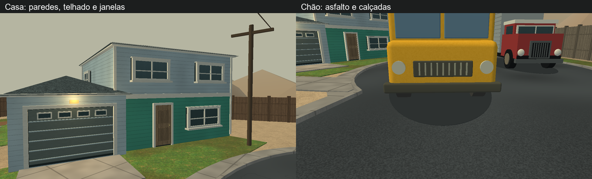

# Nuketown — Computação Gráfica

Projeto acadêmico em C++ e OpenGL, desenvolvido a partir da BaseAppOGL fornecida nas aulas. A cena recria uma parte da Nuketown clássica de Call of Duty: Black Ops: quintal de nascimento, exterior da casa e praça com ônibus e caminhão.



## Estado atual

- Cena própria da Nuketown com casa e garagem sem interiores.
- Movimentação em primeira pessoa, colisões e limites do trecho do mapa.
- Câmera opcional em terceira pessoa com personagem provisório.
- Ônibus modelado no 3ds Max, exportado em `.3ds` e carregado com Assimp.
- Grama, terra, cercas e telhados com imagens da base das aulas.
- Asfalto, concreto e pintura com detalhes calculados no shader; mistura de grama e terra.
- Janelas com molduras, montantes, peitoris e aparência de vidro.
- Iluminação direcional, ponto de luz na garagem e névoa de distância.

A aparência do vidro usa brilho e uma aproximação da cor do céu. Ainda não há cubemap de reflexão, refração nem transparência de interiores. Os arquivos das cenas de exemplo do professor continuam disponíveis como referência; a aplicação inicia apenas a Nuketown.

## Como abrir e executar

1. Clone ou baixe o repositório completo, mantendo `BaseAppOGL` e `OpenGL_SDK` lado a lado.
2. No Visual Studio, instale a carga de trabalho **Desenvolvimento para desktop com C++**, incluindo o Windows SDK e o compilador MSVC **v145**, configurado no projeto.
3. Abra `BaseAppOGL/BaseAppOGL.sln`.
4. Selecione **Debug** e **x64**. Essa é a configuração validada nesta versão.
5. Defina `BaseAppOGL` como projeto de inicialização, se necessário, e pressione **Ctrl + F5**.

Os caminhos do SDK são relativos à pasta do projeto. As DLLs necessárias já estão em `BaseAppOGL/bin/Debug`. Ao executar o `.exe` fora do Visual Studio, use `BaseAppOGL` como diretório de trabalho, pois shaders e modelos são carregados por caminhos relativos.

O programa solicita um contexto **OpenGL 4.6**; o driver de vídeo precisa oferecer suporte. O 3ds Max é usado para editar os modelos e não precisa estar instalado para executar a cena.

## Controles

| Tecla | Ação |
| --- | --- |
| W, A, S, D | Andar |
| Mouse | Olhar ao redor |
| Shift esquerdo | Correr |
| F5 | Alternar primeira e terceira pessoa |
| Enter | Abrir/fechar o menu e liberar/capturar o mouse |
| R | Voltar ao ponto inicial |
| V | Alternar sincronização vertical |
| Caps Lock | Alternar modo de arame |
| Esc | Fechar a aplicação |

O menu também permite ajustar a distância da câmera em terceira pessoa.

## Organização

```text
BaseAppOGL/
  Engine/                         Base C++/OpenGL das aulas
  Scenes/Nuketown/                 Código e shaders da cena
    Assets/Bus/                   Modelo .max, exportação .3ds, script e textura
    TEXTURAS.md                   Origem e aplicação dos materiais
  Scenes/Textures/                Texturas fornecidas nas aulas
  bin/Debug/                     DLLs necessárias em tempo de execução
  BaseAppOGL.sln                  Solução do Visual Studio
OpenGL_SDK/                      Headers, bibliotecas e licenças das dependências
previews/                        Capturas da aplicação
```

O SDK inclui GLFW, GLEW, GLM, Assimp e FreeType. Dear ImGui e stb_image fazem parte dos fontes da base. As licenças disponibilizadas com as dependências estão preservadas em suas respectivas pastas. Executáveis, caches e preferências locais do Visual Studio não são versionados.
